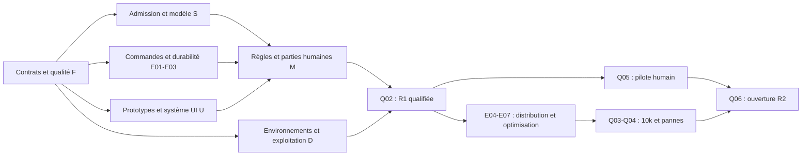

# Plan de livraison — multijoueur, expérience de jeu et production

Date : 14 septembre 2026. Statut : planification demandée par le propriétaire du produit ; tâches non exécutées. Référence factuelle : [audit du 14 septembre](../reports/AUDIT-MULTIJOUEUR-2026-09-14.md).

Ce document devient la référence d'ordre de livraison pour les améliorations demandées après l'audit. La [roadmap 20](20-Roadmap-Activation-Multijoueur-Jeux-Test.md) conserve l'historique des fonctionnalités et le périmètre SIM. Les visions antérieures décrivent des intentions, pas des preuves de livraison.

## 1. Résultat attendu

Un joueur peut choisir un jeu, rejoindre des humains, terminer plusieurs manches, retrouver ses résultats après rechargement et reprendre après une coupure. L'expérience est claire, fluide et accessible sur mobile comme sur ordinateur. L'équipe peut déployer, surveiller, restaurer et faire évoluer le produit avec des procédures vérifiées.

Deux jalons distincts :

- **R1 — Pilote multijoueur déployable** : poker, belote et rami jouables entre humains, expérience essentielle aboutie, staging qualifié, exploitation et restauration vérifiées ; ouverture limitée à la capacité effectivement testée.
- **R2 — Production à 10 000 joueurs simultanés** : moteurs répartis, absence de double propriétaire, charge et endurance à 10 000, pointe à 15 000, pannes et déploiements en cours de parties qualifiés. Aucune promesse de capacité avant ces preuves.

Les 10 000 désignent les humains connectés simultanément ; bots, spectateurs, joueurs en partie et utilisateurs au lobby sont mesurés séparément. La composition de cette population fait partie du contrat de charge.

Conserver React/TypeScript, Django/PostgreSQL et Go ; réutiliser invitations, clubs, portefeuille SIM, support et jeux de hasard existants. Préserver les travaux locaux en cours. Aucune conversion en argent réel, aucun nouvel opérateur de paiement, aucune infrastructure facturée ni publication n'est effectué par cette planification.

## 2. Décisions de conception et limites

| Sujet | Choix de travail | Point à résoudre dans le backlog |
|---|---|---|
| Structure métier | Table → session → manche → participants → résultats ; règles versionnées | Migration des données historiques et contrat exact en F02 |
| Autorité | Le serveur valide les commandes et fixe les délais ; un seul propriétaire actif par table | Journal et failover en E01–E04 |
| Règlement SIM | Transmission entre serveurs, idempotence, réconciliation | Définir buy-in, conservation des jetons et contreparties en F02 ; ne pas assimiler automatiquement chaque pot à un crédit net |
| Humains et bots | Mode humain sans remplacement IA implicite ; entraînement clairement identifié | Politique de départ/absence et filtres de présence en M01–M03 |
| UX | Direction sombre et dorée conservée, hiérarchie simplifiée, tables propres à chaque jeu | Prototypes U01–U05 avant généralisation |
| Distribution | Une région initiale sélectionnée par mesures depuis Madagascar, plusieurs domaines de panne pour R2 | Fournisseur, région et budget en D01, avant provisionnement |
| Déploiement | Images immuables, infrastructure décrite en code, migrations compatibles, drainage des tables | Orchestrateur choisi selon coût et compétence ; Kubernetes n'est pas imposé |
| Versions | Versions supportées et verrouillées | Vérification à la date de mise à niveau, changements séparés des modifications de règles |
| Innovation | Reprise guidée, replay privé, apprentissage contextualisé, mode sobre | Aucun conseil stratégique réservé à l'entraînement ne fuit vers le mode humain |

Les choix non tranchés sont suivis dans F02/D01. Ils ne bloquent pas les tâches indépendantes. Les variantes de belote et rami doivent être explicites avant de changer les règles ; aucune règle publiée n'est modifiée rétroactivement.

## 3. Organisation du travail

Statuts : **À faire → En cours → En revue → Qualifié → Livré**. Toutes les tâches ci-dessous commencent à **À faire**. « Qualifié » exige une preuve attachée ; « Livré » exige la présence de la version vérifiée dans l'environnement cible.

Rôles : PO (produit), UX (design/recherche), FE (frontend), BE (backend), GE (moteur Go), QA (qualification), OPS (exploitation). Il s'agit de responsabilités proposées, pas d'une équipe déjà affectée.

Tailles relatives : S = tâche localisée ; M = plusieurs composants ; L = changement transversal à découper en PR cohérentes. Ces tailles n'engagent ni date ni durée. Après F01–F03, estimer les sous-tâches avec l'équipe réelle et publier une prévision tenant compte de ses disponibilités ; recalibrer après chaque jalon.

Chaque tâche possède un responsable unique, même lorsqu'elle requiert plusieurs spécialités. Les dépendances ci-dessous désignent les conditions pour la qualifier, pas forcément pour commencer sa conception.

## 4. Backlog exécutable

### Lot F — Contrats et base de qualité

| ID | Priorité / taille / pilote | Travail et livrable | Dépendances | Critère d'acceptation |
|---|---|---|---|---|
| F01 | P0 / S / QA | Photographier version, WIP, services, tests et couverture réelle ; distinguer implémenté, simulé et prouvé | — | État reproductible avec SHA et diff ; aucun travail existant perdu ; registre des preuves |
| F02 | P0 / M / PO | Règles poker/belote/rami, économie SIM, nombre de sièges, départs, délais, manches et victoire ; journal de décisions | F01 | Une fiche versionnée par jeu ; écart rami 7/10 cartes résolu ; critères partagés PO/GE/QA |
| F03 | P0 / M / BE | Contrats HTTP et WebSocket versionnés, identifiants, erreurs, ACK, resync, compatibilité | F02 | Schémas et exemples exécutables ; types FE dérivés/vérifiés ; politique clients anciens |
| F04 | P0 / S / FE | Corriger lint et dépendances des hooks ; réconcilier catalogue `slots-mada` et test avec le produit | F01, F02 | Lint/build/tests concernés verts ; aucune suppression de test pour masquer le défaut |

### Lot S — Admission, intégrité et sécurité du jeu

| ID | Priorité / taille / pilote | Travail et livrable | Dépendances | Critère d'acceptation |
|---|---|---|---|---|
| S01 | P0 / M / BE | Émettre un ticket d'admission court lié à joueur/table/siège/rôle/mode ; réservation atomique | F03 | Invitation et accès privé contrôlés ; double admission concurrente sans siège doublé |
| S02 | P0 / M / GE | Vérifier JWT/claims/ticket ; interdire création arbitraire de table ; limiter origine, taille et débit | S01 | Jeton expiré, mauvaise table, mauvais rôle et rafale rejetés ; aucune modification du jeu |
| S03 | P0 / L / BE | Modèle Session/Manche/Participant/Résultat, contraintes et migration progressive | F02, F03 | Plusieurs résultats par table et un résultat par manche/joueur ; migration testée sur copie ; historiques ambigus conservés et signalés |
| S04 | P0 / L / BE | Règlement authentifié entre serveurs ; livraison durable et retry ; fermer le crédit contrôlé par le navigateur | S03, E03 | Fermer tous les navigateurs n'empêche pas le règlement ; bénéficiaire lié ; 100 répétitions sans doublon |
| S05 | P0 / M / BE | Réconciliation SIM et contrôle des invariants ; mesurer contention du compte plateforme | S04 | Équilibre des écritures, montants attendus, aucune création/destruction de jetons hors opération prévue ; écarts alertés |
| S06 | P0 / M / GE | Projections privées, événements spectateurs, doubles sessions et invalidation de l'ancienne connexion | S02, E01 | Aucun accès aux cartes cachées via snapshot/replay/spectateur ; ancienne session incapable d'agir après remplacement |

### Lot M — Parties humaines complètes

| ID | Priorité / taille / pilote | Travail et livrable | Dépendances | Critère d'acceptation |
|---|---|---|---|---|
| M01 | P0 / L / GE | Machines à états des trois jeux ; nouvelles manches et actions légales selon la phase | F02, E01 | Pas de double pioche ni reset arbitraire ; règles d'all-in/side pots, atouts, annonces et fin de manche couvertes |
| M02 | P0 / M / BE | Matchmaking par taille de groupe, présence fraîche, tickets expirés, annulation atomique | S01, F02 | Belote groupée à quatre ; joueurs hors ligne exclus ; même joueur non apparié deux fois |
| M03 | P0 / M / GE | Unifier sièges API/moteur, arrivée à la manche suivante, départ, délai de grâce et fermeture | M01, S01 | Capacités respectées ; aucun siège fantôme ; absence d'un joueur ne bloque pas indéfiniment la table |
| M04 | P0 / M / FE | Reconnexion avec nouveau ticket, ACK, séquences et resynchronisation ; état serveur prioritaire | F03, M03, S06 | Coupures de 5/30/90 s, doubles clics et changement d'onglet sans double action ; état final identique au serveur |
| M05 | P0 / L / QA | Parcours réels API + moteur + PostgreSQL, contextes navigateur distincts sans mocks métier | M01–M04, S04, U04, U05 | Poker 2/6/9 joueurs, belote 4, rami 2/4 ; au moins 10 manches par scénario ; reload et historique corrects pour tous |
| M06 | P1 / M / BE | Consolider salons privés, invitations et clubs existants ; signalement, blocage et modération | M02, M03, S06 | Invitation expirée refusée, exclusion effective, contrôle spectateur ; aucune donnée privée exposée par lien |

### Lot U — UI/UX de référence

| ID | Priorité / taille / pilote | Travail et livrable | Dépendances | Critère d'acceptation |
|---|---|---|---|---|
| U01 | P0 / M / UX | Carte des parcours et prototypes mobile/desktop : choix, attente, table, coupure, résultats | F01, F02 | Prototype manipulable de chaque état ; retours de 6–8 personnes dont débutants et joueurs habitués ; problèmes classés |
| U02 | P0 / M / FE | Design system issu de l'existant : tokens, cartes, sièges, boutons, modales, focus, messages | U01 | Galerie de composants et états ; FR/MG ; tailles de cible 44 px visées ; contrastes, clavier et texte agrandi vérifiés |
| U03 | P0 / M / FE | Accueil/lobby avec Humains, IA, Amis ; vraie disponibilité ; reprise et événements persistés | U02, M02 | Aucun faux compteur/tournoi/historique ; choix sans ambiguïté ; état vide et attente utiles |
| U04 | P0 / L / FE | Table poker : places adaptatives, cartes lisibles, pot/side pots, mise, suivi du tour et résultat | U02, F03, M01 | Présentation 2/6/9 sièges ; actions utilisables à une main ; min/max de mise issus du serveur ; animations sans blocage |
| U05 | P0 / L / FE | Tables belote et rami : équipes/plis/atout ; tri/groupement/sélection des cartes et actions alternatives au glisser | U02, F03, M01 | Règles visibles au bon moment ; cartes non masquées par les contrôles ; sélection clavier/tactile équivalente |
| U06 | P0 / M / FE | Chorégraphie commune du jeu : son opt-in, mouvement réduit, mode sobre, état de reprise compréhensible | U04, U05, M04 | L'animation suit l'événement serveur ; réseau coupé clairement signalé ; pas de fausse confirmation ; préférences conservées |
| U07 | P0 / M / QA | Validation responsive/accessibilité complète et utilisabilité FR/MG | U03–U06 | Matrice de terminaux ci-dessous ; aucun défaut bloquant clavier/lecteur d'écran ; aucun contrôle essentiel hors écran |
| U08 | P1 / M / UX | Itération observée sur première partie, compréhension des actions et résumé de fin | M05, U07 | Au moins 8/10 testeurs complètent le parcours assigné sans aide ; erreurs observées corrigées ou suivies |

### Lot E — Moteur, durabilité et architecture

| ID | Priorité / taille / pilote | Travail et livrable | Dépendances | Critère d'acceptation |
|---|---|---|---|---|
| E01 | P0 / L / GE | Sérialiser les commandes par table ; snapshots immuables ; extraire bots, timers et transport | F03 | Tests de concurrence ciblés avec `-race` ; un seul scheduler actif ; timers arrêtés à la fermeture |
| E02 | P0 / M / GE | Index connexions par table, files bornées, politique client lent, nettoyage des tables | E01 | Une émission ne parcourt pas les autres tables ; mémoire stabilisée sur création/fermeture répétées |
| E03 | P0 / L / GE | Journal durable, ACK après garantie de persistance, snapshots monotones, rejouabilité et outbox de résultats | E01, S03 | Crash avant/après ACK reproduit ; aucune action confirmée perdue ; snapshot ancien refusé ; résultat redélivré |
| E04 | P1 / L / GE | Propriétaire distribué de table, bail, génération/fencing, routage, reprise et drainage | E03, D02 | Deux moteurs ne peuvent accepter des écritures concurrentes pour la même génération ; partition et crash testés |
| E05 | P1 / M / BE | Présence TTL et notifications de matchmaking, pagination, index SQL, télémétrie groupée | M02, F03 | Fréquence de polling réduite ; tests de requêtes et plans SQL ; pas de présence fantôme durable |
| E06 | P1 / M / FE | Découper GamePage et charger les jeux à la demande ; adapter cache PWA et compatibilité des versions | U04, U05, F03 | Chargement initial allégé ; mise à jour différée en partie ; aucun cache public de cartes, jetons ou réponses privées |
| E07 | P1 / M / BE | Verrouiller et actualiser dépendances/images ; aligner local, CI et production | F04, D02 | Versions supportées vérifiées lors du changement ; builds reproductibles ; scans et migration documentés |

### Lot D — Déploiement et exploitation

| ID | Priorité / taille / pilote | Travail et livrable | Dépendances | Critère d'acceptation |
|---|---|---|---|---|
| D01 | P0 / M / OPS | Comparer régions/fournisseurs, latence MG, coûts à vide/pilote/10k, exigences données et budget | F01 | Décision chiffrée et datée ; plafond de dépense et périmètre du pilote explicités avant ressources payantes |
| D02 | P0 / L / OPS | Environnements local/staging/prod ; infrastructure en code, images immuables, réseau privé, TLS et secrets | D01, F03 | Staging reconstruisible ; pas de Vault dev, base/cache publiés ou secrets par défaut ; digest de version observable |
| D03 | P0 / M / OPS | CI bloquante, artefacts, migrations compatibles, déploiement progressif et retour arrière | D02, F04, E07 | Déploiement réel en staging ; checks de tous les services ; exercice de rollback sans effacement de données |
| D04 | P0 / M / OPS | Sauvegarde SQL/archives, restauration isolée, réconciliation après incident | D02, E03, S05 | Restauration chronométrée ; résultats et journal réconciliés ; procédures et responsabilités connues |
| D05 | P0 / M / OPS | Métriques/traces/logs, tableaux de bord, alertes et journal d'incident | D02, F03 | Latence/erreurs/queues/reconnexions/règlements mesurés ; alerte synthétique livrée au canal configuré ; aucun token/carte cachée dans les logs |
| D06 | P0 / M / OPS | Runbooks, sondes dépendances, maintenance, kill switches, limite d'admission et support | D03–D05, M06 | Répétition d'incident ; fermeture aux nouveaux joueurs sans perdre les parties ; capacité du pilote plafonnée |

### Lot Q — Qualification et lancement

| ID | Priorité / taille / pilote | Travail et livrable | Dépendances | Critère d'acceptation |
|---|---|---|---|---|
| Q01 | P0 / M / QA | Matrice de tests et preuves versionnées, régression contrats, règles et invariants | F02, F03 | Chaque défaut de l'audit relié à un test ou exercice pertinent ; données de test isolées |
| Q02 | P0 / M / QA | Qualification R1 sur staging, 100 puis 500 connexions, parcours et déploiement contrôlé | M05, U07, U08, E02, E03, D03–D06, Q01 | Gates R1 ci-dessous ; rapport du SHA réellement déployé ; plafond établi par les mesures |
| Q03 | P1 / L / QA | Générateurs HTTP/WS externes, charge 1k/5k/10k/15k, profilage et coût | E04, E05, E07, D05, Q02 | Objectifs de charge ci-dessous ; générateurs non saturés ; rapport matériel/coût/trafic/version reproductible |
| Q04 | P1 / L / QA | Endurance 8 h à 10k et pannes : moteur, stockage, file, DB, réseau, rolling deploy | Q03, D04, D06 | Pas de perte d'action confirmée ni double règlement ; mémoire stabilisée ; RTO observé ; réserve de capacité |
| Q05 | P0 / M / PO | Pilote fermé, observations joueurs, signalements et décision d'ouverture | Q02, U08, M06 | Cohorte recrutée et retours réels ; défauts bloquants corrigés ; scorecard et décision documentées |
| Q06 | P1 / M / OPS | Ouverture R2 progressive avec seuils de retour arrière et surveillance | Q04, Q05 | 10/25/50/100 % selon cohorte/capacité ; pause automatique ou opérateur si seuil violé ; responsable d'exploitation désigné |

### Lot I — Innovations utiles après stabilisation des parcours

| ID | Priorité / taille / pilote | Travail et livrable | Dépendances | Critère d'acceptation |
|---|---|---|---|---|
| I01 | P1 / M / FE | Reprise guidée : « vous avez manqué ces actions », tour actuel, temps restant ; continuité après reconnexion | M04, E03, U06 | Résumé issu du journal autorisé ; pas d'information cachée ; pas d'action stratégique automatique |
| I02 | P2 / M / FE | Replay privé et résumé pédagogique de fin de manche, partage expurgé optionnel | S06, E03, S04 | Seules les cartes autorisées sont visibles ; lien révocable/expirable ; replay sans modifier le résultat |
| I03 | P2 / M / UX | Parcours d'apprentissage interactif dans l'entraînement, aide contextuelle expliquant les règles | F02, U05, U08 | Débutant termine un exercice ; IA clairement annoncée ; aucune assistance privilégiée transférée au mode humain |
| I04 | P2 / M / BE | Rendez-vous entre amis, revanche et invitations dans les clubs existants | M06, S04 | Places réellement réservées, notifications choisies, aucune activité fictive ; annulation possible |

P0 bloque le pilote selon son gate. P1 bloque R2 lorsqu'il concerne capacité/résilience ; I01 et U08 améliorent l'expérience selon leurs jalons. P2 peut être livré après R1 et ne retarde pas les correctifs critiques. Les innovations ne doivent pas fragmenter les files de matchmaking ni ajouter un coût incompatible avec le mode sobre.

## 5. Séquence d'exécution



Vague 1 : F01–F04, U01 et D01 ; définir le contrat puis commencer S01/S03/E01.

Vague 2 : S02/S06, E02/E03, M01–M04, U02–U06 et staging D02 ; intégrer les changements par parcours complet. Livrer d'abord un poker à deux humains avec plusieurs manches et résultats persistés, puis belote à quatre et rami.

Vague 3 : S04/S05, M05/M06, U07/U08, D03–D06 et Q01/Q02 ; pilote Q05. E07 doit être terminé avant D03. Les validations UX et les correctifs se poursuivent pendant le pilote.

Vague 4 : E04–E06, Q03/Q04, ouverture Q06. I01 peut accompagner la reprise ; I02–I04 passent par prototype et mesure de valeur avant intégration.

Les branches de travail peuvent avancer simultanément si les ressources existent, mais les migrations, contrats partagés et intégrations sont coordonnés. Cette représentation ne suppose pas plusieurs agents ni plusieurs développeurs déjà disponibles.

## 6. Premier incrément à lancer

Objectif : **une partie poker entre deux humains, trois manches, résultats distincts persistés et reprise après déconnexion**, sur un environnement isolé. Ce premier incrément valide l'architecture avant de généraliser l'interface aux trois jeux.

1. F01 : capturer baseline et préserver WIP ; F04 : supprimer les échecs de qualité existants après diagnostic.
2. F02/F03 : contrat minimal table/session/manche/joueur/résultat, économie SIM, admission et ACK.
3. U01 : prototype poker et états attente/reconnexion/règlement ; U02 : composants nécessaires à ce parcours.
4. S01/S02 : admission réelle ; S03 : migration compatible du modèle de résultats.
5. E01/E03 : commandes sérialisées et persistance ; S04 : règlement durable côté serveur.
6. M01/M03/M04 et U04 : poker, sièges, départ/reconnexion et actions confirmées.
7. M05/Q01, périmètre poker initial : deux navigateurs réels, plusieurs manches, fermeture du gagnant avant règlement, reload et réconciliation.

Les tâches transversales ne sont pas marquées entièrement terminées parce que ce seul parcours passe. La belote, le rami, les autres capacités de table et les scénarios négatifs restent dans leurs gates respectifs.

## 7. Exigences UI/UX détaillées

| Écran / état | Résultat recherché | Preuve |
|---|---|---|
| Accueil | Une action principale ; modes identifiables ; reprise réelle ; aucun contenu personnel fictif | Données persistées et tests invité/connecté/sans historique |
| Lobby | Humains disponibles, sièges, règles et mode ; attente honnête ; accès amis | Parcours sans auto-bascule IA ; test annulation et invitation |
| Table | Main personnelle lisible, adversaires identifiables, tour/temps/action évidents | Tactile, souris et clavier sur chaque jeu et capacité |
| Action réseau | Action en attente distincte d'action acceptée ; pas de « succès » avant ACK durable | Coupure juste avant/après clic, ACK perdu et retry |
| Reconnexion | Reprise contextualisée, aucun reset de main ; délai serveur visible | 5/30/90 s hors ligne, veille mobile et changement de réseau |
| Résultat | Résumé explicite, gain net versus pot distincts, statut du règlement et historique | Tous les participants retrouvent leur résultat après reload |
| Erreur | Cause compréhensible, action de reprise, référence support non sensible | Erreurs métier, réseau, capacité, session expirée |
| Préférences | FR/MG, son choisi, réduction d'animation et économie de données | Persistance des choix, contrôle clavier et mode sobre |

Matrice de qualification : 360/390/430 px portrait, paysage mobile, tablette 768 px et desktop 1440 px ; zoom texte 200 % ; Android physique de gamme modeste avec caractéristiques consignées ; Chrome/Firefox desktop et Safari iOS selon disponibilité des appareils. Un navigateur non vérifié est signalé comme tel.

Prototypes : montrer l'état normal mais aussi attente, absence de joueurs, spectateur, fin de manche, erreur et déconnexion. L'animation est une restitution du serveur ; une carte ne devient jamais jouable ou injouable à cause de sa durée. La modification du montant de mise reste possible sans glisser. Les cartes restent distinguables sans dépendre uniquement de leur couleur.

Objectifs de performance proposés : LCP p75 ≤ 2,5 s et INP p75 ≤ 200 ms sur le profil de référence ; profil mesuré à 10 Mbps descendants, 2 Mbps montants, RTT 80 ms, sans perte. Tester aussi 1 Mbps/256 kbps, RTT 300 ms et 2 % de pertes avec des critères de continuité, sans lui appliquer le même budget de latence. Mesurer sur terminaux réels et préciser conditions/cache/version ; 60 fps visés sur appareil de référence, mode réduit disponible quand nécessaire.

## 8. Gates de livraison

### R1 — Pilote multijoueur déployable

- [ ] F01–F04, S01–S06, M01–M06, U01–U08, E01–E03, E07, D01–D06, Q01 et Q02 qualifiés dans leur périmètre.
- [ ] Parcours réels des trois jeux ; plusieurs manches ; règles et confidentialité vérifiées ; résultats de tous les participants persistés.
- [ ] Aucun défaut critique connu d'admission, perte de données, double règlement ou blocage de partie ; défauts restants documentés avec impact et responsable.
- [ ] Staging reconstruit et déployé ; migration, rollback applicatif, arrêt des admissions et restauration exercés.
- [ ] Capacité 100 puis 500 connexions testée pendant une heure à chaque palier ; admission du pilote plafonnée sous la capacité validée avec réserve.
- [ ] Accueil, tables, modales et erreurs testés en FR/MG ; aucune violation axe critique/sérieuse non traitée sur les parcours ; contrôle manuel clavier et lecteur d'écran.
- [ ] Procédures, tableaux de bord, sauvegardes, responsable et canal support prêts ; choix externes de D01 et contenu destiné au pilote finalisés.

La qualification R1 n'est pas une preuve de 10 000 joueurs. Q05 suit avec le pilote réel et ses retours avant ouverture élargie.

### R2 — 10 000 simultanés et marge

- [ ] Gates R1, E04–E06, Q03–Q05 passés ; Q06 préparé.
- [ ] 10 000 connexions pendant 8 h et pointe 15 000 pendant 30 min ; ramp-up/ramp-down, renouvellement JWT et tempête de reconnexions inclus.
- [ ] Scénario A : 70 % joueurs actifs, 20 % lobby, 10 % spectateurs ; scénario B : 100 % actifs ; répartition initiale actifs 50 % poker, 25 % belote, 25 % rami. Scénario C : lobby saturé. Définir cadence réaliste des actions à partir des sessions R1. Ajouter des bots comme charge séparée.
- [ ] Traitement serveur action p95 < 100 ms ; clic → ACK p95 < 300 ms sur profil réseau de référence ; erreurs techniques < 0,1 % des commandes valides. Inclure timeouts et pertes d'ACK dans les erreurs ; séparer refus métier attendus.
- [ ] Au moins 30 % de réserve sur la ressource limitante à 10k, y compris avec perte d'une instance selon dimensionnement retenu ; absence de croissance mémoire/queues après échauffement et récupération après pointe.
- [ ] Crash moteur : reprise < 30 s ; RPO 0 pour actions confirmées face aux pannes d'instance couvertes ; aucun double propriétaire ni double résultat. Pour sinistre régional, objectif initial RPO ≤ 5 min/RTO ≤ 60 min à confirmer en D01/D04 ; suspension et réconciliation explicites avant réouverture.
- [ ] Déploiement progressif sans interrompre arbitrairement une manche ; clients anciens traités selon politique de compatibilité.
- [ ] Coût mesuré, limites, alertes et procédure de retour arrière approuvés pour la capacité visée.

Les seuils ci-dessus sont des objectifs de qualification proposés, jamais des résultats présumés. Si un palier échoue, conserver la dernière capacité validée et traiter la cause avant de relever le plafond.

## 9. Définition de terminé et preuves

Chaque tâche inclut : comportement avant/après ; cas limites ; changement de contrat/migration le cas échéant ; tests proportionnés ; preuve sur la version exacte ; impact sur métriques, exploitation et retour arrière. Une capture ou un toast ne remplace pas la preuve de persistance.

Fiche de suivi à utiliser pour chaque tâche :

```text
ID / responsable / statut / taille réestimée :
Périmètre et dépendances :
Décisions encore ouvertes :
PR / SHA / environnement / date :
Critères passés et preuve :
Critères non passés ou non testés :
Migration / rollback / risques restants :
Prochaine action :
```

Regrouper les preuves sous `reports/` par lot et version : résultats automatisés, captures utiles, traces expurgées, rapports de charge, métriques et exercices de restauration. Ne jamais inclure tokens, secrets, cartes cachées d'autrui ou données personnelles de production.

## 10. Suivi produit et décision d'ouverture

Mesurer sans gonfler les compteurs : humains uniques, ratio entrée → première partie, délai d'attente par jeu/mode, parties terminées, reconnexions réussies, commandes rejetées pour raison technique, règlements en retard et signalements. Définir « première partie » et « session terminée » dans F02 ; les bots n'entrent pas dans les KPI humains.

Cible pilote indicative : 20–50 personnes, au moins 100 sessions terminées sur les trois jeux et une séance observée dans chaque langue. Ces nombres constituent un minimum de retour produit, pas une preuve statistique de disponibilité. Aucun classement ou taux de rétention simulé ne permet de déclarer le pilote réussi.

L'ouverture est décidée sur les gates techniques, les retours réels, la capacité mesurée et l'exploitation disponible. Le plan ne comporte pas de date artificielle ni de score « 10/10 » : l'avancement est attaché aux tâches et à leurs preuves.
