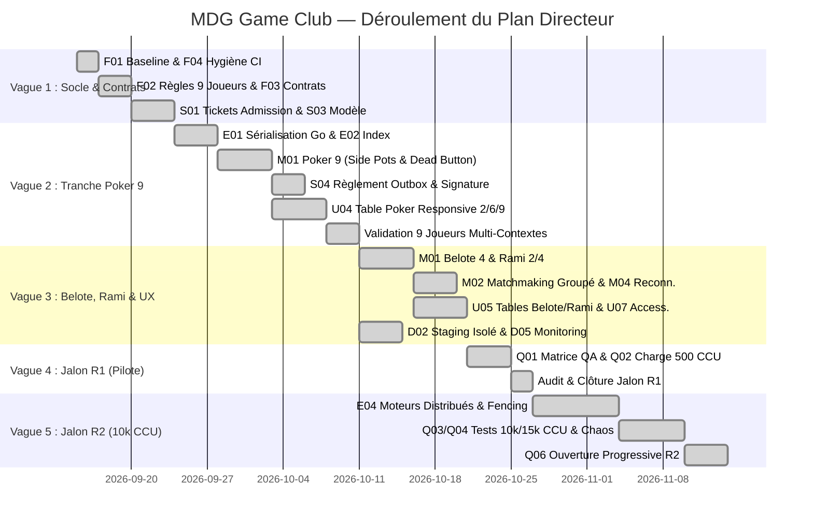

# MDG Game Club — Plan Directeur : Multijoueur, Poker jusqu'à 9 Joueurs (Full Ring) et Mise en Production

**Date :** 14 septembre 2026  
**Version :** 3.0 — Plan Directeur Unifié  
**Statut :** Planification exécutive validée, intégrant les formats Poker Full Ring (9 joueurs), 6-Max (6 joueurs) et Heads-Up (2 joueurs), les exigences de l'[audit empirique du 14 septembre 2026](../reports/AUDIT-MULTIJOUEUR-2026-09-14.md), et les jalons de livraison R1 et R2.  
**Périmètre :** Simulation intégrale (jetons SIM), multijoueur temps réel (Poker, Belote, Rami), robustesse réseau, infrastructure et haute disponibilité.

---

## 1. Vision et Objectifs Clés

Ce document constitue la référence contractuelle et technique pour le développement, la qualification et le déploiement de la plateforme multijoueur. Il synthétise et remplace les plannings opérationnels précédents ([Roadmap 20](20-Roadmap-Activation-Multijoueur-Jeux-Test.md) et [Plan 21](21-Plan-Livraison-Multijoueur-UX-Production.md)).

### Deux Jalons Stratégiques de Livraison
1. **Jalon R1 — Pilote Multijoueur Déployable (100 à 500 joueurs simultanés)** :
   * **Poker complet** jouable en configurations **2 joueurs (Heads-Up)**, **6 joueurs (6-Max)** et **jusqu'à 9 joueurs (Full Ring)**.
   * **Belote classique** (4 joueurs en 2 équipes) et **Rami** (2 à 4 joueurs) pleinement fonctionnels.
   * Persistance exacte multi-manches et multi-participants, règlement serveur-à-serveur infalsifiable.
   * Reconnexion mobile tolérante aux micro-coupures et latences du réseau malgache.
   * Staging qualifié avec runbooks d'exploitation et cohorte pilote de 20 à 50 testeurs réels.
2. **Jalon R2 — Production Haute Disponibilité (10 000 joueurs simultanés)** :
   * Architecture de moteurs Go distribués avec propriété exclusive des tables (*table ownership & fencing*).
   * Tenue en charge de 10 000 connexions WebSocket actives pendant 8 heures et pointe à 15 000 connexions.
   * Résilience aux sinistres (crash nœud moteur, coupure Redis, failover DB) avec $RPO = 0$ sur les actions confirmées.

---

## 2. Spécification Détaillée : Le Poker jusqu'à 9 Joueurs (Full Ring)

Le poker en ligne ne peut se limiter à un tête-à-tête (Heads-Up). Le standard international et l'attente des joueurs de cartes reposent sur des tables complètes à 6 ou 9 sièges.

### 2.1. Matrice des Formats Poker Supportés

| Format | Capacité | Quorum de Démarrage | Description & Cible |
|---|---|---|---|
| **Heads-Up** | 2 joueurs | 2 joueurs | Duel rapide à haute intensité. |
| **6-Max (Short-Handed)** | 6 joueurs | 2 joueurs | Format dynamique, standard des parties en ligne modernes. |
| **Full Ring** | 9 joueurs | 2 ou 3 joueurs | Format classique des tables de casino et tournois, profondeur stratégique maximale. |

### 2.2. Impacts Métier & Architecture Moteur Go (`game-engine/`)

1. **Calcul des Pots Multiples et Pots Secondaires (*Side Pots*)** :
   * À 9 joueurs, des écarts de tapis considérables mènent fréquemment à 3, 4 voire 5 joueurs à tapis (*all-in*) avec des mises inégales.
   * Le module [`poker.go`](../game-engine/internal/game/poker/poker.go) ségrège les mises par strates de tapis et calcule une liste ordonnée de `Pot { Amount int64, Eligible []string }`.
   * Lors du showdown, chaque pot secondaire est attribué indépendamment aux seules mains éligibles, en gérant le partage strict (*split pot*) au jeton près.
2. **Dynamique du Bouton (Dealer), Small Blind et Big Blind** :
   * Déplacement horaire automatique du bouton Dealer `(button + 1) % len(active_players)`.
   * Règle du *Dead Button* : lorsqu'un joueur au bouton ou en blinde est éliminé ou quitte la table, la position des blindes reste équitable sans désavantager les joueurs actifs.
3. **Quorum & Arrivées Dynamiques (*Sit-in / Sit-out*)** :
   * Une table Full Ring ne doit pas attendre 9 joueurs pour tourner : dès que 2 joueurs sont assis et prêts, les mains s'enchaînent.
   * Un nouveau joueur rejoignant la table pendant une main active est placé en statut `WAITING_FOR_NEXT_HAND` et ne reçoit ses cartes qu'à la manche suivante, payant sa blinde selon les règles de tour de table.
4. **Gestion des Déconnexions et Délais de Grâce** :
   * Chaque joueur dispose d'une minuterie d'action visible (`action_deadline` : 15 à 20s).
   * En cas d'expiration sans action reçue, le moteur exécute un `Check` si aucune mise n'est requise, ou un `Fold` automatique.
   * Si un joueur est déconnecté, un délai de grâce supplémentaire de 30 secondes est accordé avant mise en pause automatique (*Auto-Sit-Out*), évitant de paralyser les 8 autres joueurs de la table.

### 2.3. Ergonomie & UI/UX Responsive pour 9 Sièges (Tâche U04)

Le défi d'une table à 9 sièges est de garantir une lisibilité absolue sur mobile (360px, 390px, 430px) sans saturer l'écran :

```text
                           [Siège 5]
              [Siège 6]                  [Siège 4]
        [Siège 7]                              [Siège 3]
              [Siège 8]                  [Siège 2]
                     [Siège 0 : HERO (Moi)]
                       [Barre d'Actions]
```

* **Perspective Centrée (*Hero Seat*)** : Le joueur local est toujours positionné au centre bas (Siège 0 virtuel). Les 8 autres sièges sont distribués le long d'une ellipse calculée en trigonométrie SVG/CSS.
* **Lisibilité des Cartes** : Cartes privées du joueur local agrandies et interactives ; cartes fermées des adversaires compactes avec badges de statut (Mise courante, Tapis restant, Dealer Button, Vainqueur).
* **Zone Centrale Dédiée** : Cartes communes (Flop, Turn, River) clairement séparées, affichage du Pot Total et décomposition dynamique des Side Pots (ex: `Pot Principal: 1 200 | Side Pot 1: 600`).
* **Commandes Utilisables à une Main sur Mobile** :
  * Trois gros boutons tactiles prioritaires : `Fold`, `Check / Call [montant]`, `Bet / Raise`.
  * Molette/Slider de mise tactile complété par 5 raccourcis universels : `Min`, `1/2 Pot`, `2/3 Pot`, `Pot`, `All-In`.

---

## 3. Backlog Technique Révisé & Priorisé

### Lot F — Contrats, Qualité et Hygiène de Code
* **F01 (P0 / S / QA) — Capture de la baseline et gel du WIP** :
  * Sécuriser l'arborescence git locale (`git status`), archiver le diff, vérifier l'intégrité des composants.
* **F02 (P0 / M / PO) — Fiche de règles formelles Poker 2/6/9, Belote 4 et Rami 2/4** :
  * Valider les règles de mises, blindes, side pots, quorum, et arbitrage définitif du Rami (alignement 7 vs 10 cartes).
* **F03 (P0 / M / BE) — Contrats d'API et enveloppes WebSocket versionnées** :
  * Format unifié : `{ event_id, table_id, seat_id, type, seq, payload, timestamp }`.
  * Acquittements mutuels (ACK), resynchronisation sur reconnexion et typage TypeScript partagé.
* **F04 (P0 / S / FE) — Nettoyage qualité & CI bloquante** :
  * Résolution des 4 erreurs ESLint dans `GamePage.tsx` et warnings de hooks.
  * Réconciliation du test `backend/apps/games/tests/test_test_games.py` avec le catalogue `slots-mada`.

### Lot S — Sécurité, Admission et Intégrité Comptable
* **S01 (P0 / M / BE) — Ticket d'admission sécurisé (Handshake)** :
  * Génération par Django d'un JWT d'admission court (TTL 60s) contenant `user_id`, `table_id`, `seat_id`, `mode`, `role`.
  * Réservation atomique du siège en base de données avant connexion WebSocket.
* **S02 (P0 / M / GE) — Validation stricte côté Moteur Go** :
  * Contrôle complet des claims JWT (signature, `exp`, table, rôle).
  * Limitation de l'origine (CORS/CheckOrigin), quotas de messages (`SetReadLimit`) et interdiction formelle de créer une table sans autorisation Django.
* **S03 (P0 / L / BE) — Refonte du Modèle de Persistance (Session / Manche / Participant / Résultat)** :
  * Remplacement de l'unicité globale de `game_id`.
  * Hiérarchie relationnelle : `Table` $\to$ `Session` $\to$ `Manche` $\to$ `Participant` (jusqu'à 9) $\to$ `Résultat`.
  * Unicité de la paire `(manche, participant)` garantissant l'enregistrement de tous les joueurs et de toutes les manches.
* **S04 (P0 / L / BE) — Règlement Serveur-à-Serveur & Outbox** :
  * Fin du crédit initié par le navigateur client.
  * Le moteur Go publie la fin de manche dans une file de résultats durables. Django consomme et crédite les portefeuilles SIM de manière transactionnelle et idempotente.
* **S05 (P0 / M / BE) — Audit comptable SIM et invariants financiers** :
  * Vérification stricte : $\sum \text{Gains distribués} = \sum \text{Mises prélevées} - \text{Commission éventuelle}$. Aucune création monétaire non tracée.
* **S06 (P0 / M / GE) — Projections privées et anti-triche** :
  * Le moteur Go ne transmet jamais les cartes cachées des adversaires dans les trames WebSocket publiques. Les snapshots sont filtrés par destinataire.

### Lot M — Moteur de Jeu & Expérience Multijoueur
* **M01 (P0 / L / GE) — Machines à états des trois jeux** :
  * **Poker 2/6/9** : Déroulement complet (Preflop, Flop, Turn, River, Showdown), multi-pots, side pots, dead button, all-ins successifs.
  * **Belote 4** : Enchères/contrat, atout, annonce, plis, décompte par équipe de 2.
  * **Rami 2/4** : Pioche unique par tour, combinaisons légales, dépose, défausse, clôture.
* **M02 (P0 / M / BE) — Matchmaking par groupe et format de jeu** :
  * Suppression de la contrainte codée en dur à 2 joueurs.
  * Files configurables : Poker Heads-Up (2), 6-Max (6), Full Ring (9), Belote (4), Rami (2 ou 4).
  * Filtrage strict par présence fraîche (éviction des joueurs hors-ligne).
* **M03 (P0 / M / GE) — Gestion dynamique des sièges et transitions de table** :
  * Prise en charge des sièges libres, arrivées en attente de la manche suivante, départs anticipés, auto-sit-out après déconnexion.
* **M04 (P0 / M / FE) — Reconnexion robuste et reprise d'état** :
  * Reconnexion automatique avec renouvellement transparent du ticket d'admission.
  * Reprise de la séquence via `sync_request` sans perte de main ni double action.
* **M05 (P0 / L / QA) — Tests de parcours réels multi-navigateurs** :
  * Validation Playwright et tests manuels sur **9 contextes navigateurs réels simultanés** pour le Poker Full Ring (au moins 10 manches consécutives avec éliminations, tapis et recharges).
* **M06 (P1 / M / BE) — Tables privées de club et modération** :
  * Consolidation des tables de club (supportant également de 2 à 9 joueurs) et modération du chat de table.

### Lot U — Interface Utilisateur (UI/UX) & Responsive Design
* **U01 (P0 / M / UX) — Prototypage et validation ergonomique des tables** :
  * Maquettes interactives des tables 9 sièges, 6 sièges et 2 sièges sur viewports 360px, 390px, 768px et 1440px.
* **U02 (P0 / M / FE) — Système de composants de table réutilisables** :
  * Sièges, cartes à jouer vectorielles contrastées, jauges de temps, jetons empilés, indicateurs D/SB/BB.
* **U03 (P0 / M / FE) — Lobby & Sélecteur de formats** :
  * Sélection intuitive : Choix du jeu $\to$ Choix du format (Heads-Up / 6-Max / Full Ring) $\to$ Niveau de mise.
* **U04 (P0 / L / FE) — Intégration de la Table Poker 2/6/9 Adaptative** :
  * Calcul géométrique des positions de sièges en fonction du nombre maximum configuré (2, 6 ou 9).
  * Composant mobile-first fluide avec animations non-bloquantes et contrôles tactiles ergonomiques.
* **U05 (P0 / L / FE) — Tables Belote (4) et Rami (2/4)** :
  * Table Belote orientée équipe (Nord/Sud vs Est/Ouest), tapis de pli central, indicateur d'atout.
  * Table Rami avec zone de combinaisons étalées, défausse et pioche tactile.
* **U06 (P0 / M / FE) — Chorégraphie sonore et mode sobre** :
  * Sons discrets et désactivables par défaut, respect de `prefers-reduced-motion`, mode basse consommation de données pour réseaux 3G.
* **U07 (P0 / M / QA) — Accessibilité WCAG 2.2 & Traduction Intégrale FR/MG** :
  * Vérification du contraste des cartes (couleurs + symboles distincts), accessibilité clavier, libellés 100% bilingues français et malgache.

### Lot E — Architecture Moteur, Concurrence & Échelle
* **E01 (P0 / L / GE) — Boucle de commandes sérialisées par table** :
  * Élimination des conditions de course (`go test -race ./...`). Chaque table possède sa boucle de messages sérialisée et ses snapshots immuables.
* **E02 (P0 / M / GE) — Indexation des connexions par table et files bornées** :
  * Émission sélective des messages aux seuls joueurs assis à la table concernée (complexité $O(N_{\text{table}})$ au lieu de $O(N_{\text{total}})$).
  * Gestion propre de l'éviction des clients lents.
* **E03 (P0 / L / GE) — Journal d'événements et snapshots monotones** :
  * Snapshots versionnés rejetant les écritures tardives, sauvegarde d'état résistante au redémarrage d'instance.
* **E04 (P1 / L / GE) — Propriétaire distribué de table & Fencing (Jalon R2)** :
  * Coordination multi-nœuds moteur avec bail de table distribué évitant toute écriture concurrente split-brain.
* **E05 (P1 / M / BE) — Présence éphémère Redis & Allègement de charge** :
  * Remplacement du polling lourd du lobby par des sessions éphémères Redis avec TTL et événements pub/sub.

### Lot D — Déploiement, DevOps & Exploitation
* **D01 (P0 / M / OPS) — Choix d'infrastructure & Latence Madagascar** :
  * Sélection de la région cloud la plus performante vers Madagascar (ex: Afrique du Sud / Kenya ou Europe Ouest selon RTT mesuré).
* **D02 (P0 / L / OPS) — Infrastructure as Code (IaC) & Staging Isolé** :
  * Déploiement staging automatisé avec conteneurs immuables, secrets gérés et réseau privé.
* **D03 (P0 / M / OPS) — CI/CD Bloquante & Procédures de Rollback** :
  * Pipeline automatisé : Lint $\to$ Tests Unitaires $\to$ Tests Concurrence Race $\to$ Tests E2E $\to$ Déploiement sans coupure.
* **D04 (P0 / M / OPS) — Stratégie de sauvegarde & Reprise d'activité (DRP)** :
  * Sauvegarde continue PostgreSQL, tests de restauration chronométrés et réconciliation des bilans.
* **D05 (P0 / M / OPS) — Observabilité Complète (Métriques, Logs, Tracing)** :
  * Tableaux de bord Prometheus / Grafana : latence p95, taux de reconnexion, parties actives par jeu/format, alertes temps réel.
* **D06 (P0 / M / OPS) — Runbooks & Drainage propre des tables** :
  * Procédure de mise à jour permettant aux tables en cours de terminer leur manche avant bascule logicielle (*graceful drain*).

### Lot Q — Qualification, Charge & Lancement
* **Q01 (P0 / M / QA) — Matrice de validation fonctionnelle R1** :
  * Validation systématique des 47 points critiques de l'audit du 14 septembre.
* **Q02 (P0 / M / QA) — Qualification Staging R1 (100 à 500 CCU)** :
  * Épreuve de charge simulée avec k6 : 500 connexions concurrentes réparties sur Poker 2/6/9, Belote et Rami.
* **Q05 (P0 / M / PO) — Exécution du Pilote Fermé Réel** :
  * Déploiement auprès de 20 à 50 testeurs réels, débriefing des parties, analyse du feedback et décision Go/No-Go.
* **Q03 / Q04 (P1 / L / QA) — Qualification de l'Échelle R2 (10 000 à 15 000 CCU)** :
  * Tirs de charge massifs à 10 000 connexions WebSocket pendant 8 heures et pointe à 15 000 CCU.
  * Tests d'injection de pannes (arrêt brutal d'un moteur, redémarrage Redis, latence SQL) avec vérification de l'intégrité comptable.
* **Q06 (P1 / M / OPS) — Déploiement Progressif R2** :
  * Ouverture contrôlée (10% $\to$ 25% $\to$ 50% $\to$ 100%) avec coupe-circuit automatique en cas de dépassement des seuils de latence ou d'erreur.

---

## 4. Chronogramme d'Exécution par Vagues



---

## 5. Critères de Réussite et Définition de Terminé (DoD)

Une fonctionnalité ou une tâche n'est déclarée **Livrée** que si elle répond aux exigences suivantes :

1. **Preuve Runtime & Données Réelles** :
   * Pas de mocks pour valider les parties : les tests de validation doivent faire communiquer les vrais processus API Django, Moteur Go et navigateurs clients.
2. **Capacité 9 Joueurs Éprouvée** :
   * Une partie complète de Poker à 9 participants distincts se déroule sans accroc sur au moins 10 mains consécutives, avec redistribution exacte des jetons pour chaque pot principal et secondaire.
3. **Zéro Écart Comptable** :
   * Les crédits et débits du portefeuille SIM correspondent exactement au bilan des mains enregistrées dans PostgreSQL.
4. **Résistance Réseau Mobile** :
   * Une coupure de connexion de 15 secondes sur un smartphone ne fait perdre ni la main du joueur ni son siège, et l'interface se resynchronise dès le retour du signal.
5. **CI et Qualité d'Ingénierie** :
   * `npm run lint` et `npm test` 100% verts.
   * `pytest` 100% vert sur l'ensemble de la suite backend.
   * `go test -race ./...` 100% vert sur l'ensemble des modules du moteur Go.
