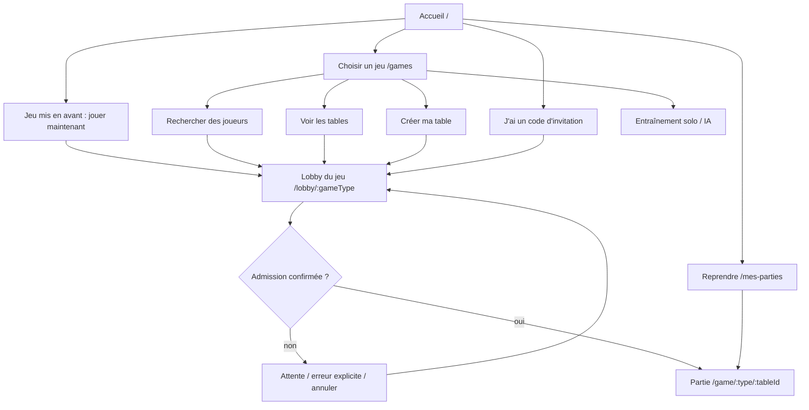

# Casino-MDG — Audit de navigation, sitemap cible et plan de refonte v3

Date : 14 novembre 2026  
Base auditée : branche `master`, commit `340c067d3f29ae4decf5d1ead23ac788594762db`  
Branche de réalisation : `feat/ux-direct-play-entry-2026-11-14`  
Statut : incrément UX proposé, **non déployé et non certifié en conditions réelles**

## 1. Executive summary

**Problème utilisateur rapporté** : depuis la première visite, il est difficile de trouver une partie multijoueur, de rejoindre une table publique, d'en créer une et de commencer à jouer. Le vocabulaire interne « lobby / session / matchmaking » ne doit pas être un préalable pour le joueur.

**Constat vérifié dans le code** : des refontes substantielles sont déjà fusionnées (PR #48, #49, #50). Le lobby spécifique d'un jeu possède `GameLobbyEntryActions`, création rapide, tables filtrables, file d'attente et reprise. Cependant, depuis le hero d'accueil, le parcours principal est encore Accueil → Jeux → Lobby du jeu → « Trouver des joueurs ». Le catalogue propose un vaste lien vers les tables et un bouton supplémentaire « Accéder aux tables », mais ne donne pas de bouton multijoueur direct. `PlayHubPage.tsx` demeure dans le dépôt bien que `/play/:gameType` soit redirigé vers le lobby. `LobbyPage.tsx` contient environ 2 500 lignes et `GamePage.tsx` est volumineux : risque de couplage et de régression, non mesure directe d'échec UX.

**Décision** : conserver les contrats backend et la sûreté financière, améliorer l'entrée dans l'expérience par un premier petit incrément, puis simplifier l'architecture via PR incrémentales. Ne pas créer de deuxième système de matchmaking.

## 2. Arborescence observée et cible

### Arborescence existante (routes vérifiées dans `frontend/src/App.tsx`)

- `/` : accueil, hero, invitations, reprise, intentions, jeux mis en avant.
- `/games` : catalogue cinq jeux et intentions `?intent=create` et `?intent=practice`.
- `/lobby/:gameType` : jeu spécifique, matchmaking, tables publiques, création rapide, invitation.
- `/lobby` : lobby transversal, filtres, tournois, création et entraînement.
- `/game/:gameType/:tableId` : session et plateau.
- `/mes-parties` : reprise confirmée et autres sièges.
- `/auth`, `/wallet`, `/profile`, `/clubs`, `/support`, `/backoffice`.
- `/play/:gameType` : redirection de compatibilité vers `/lobby/:gameType`.

### Sitemap cible (vocabulaire joueur)

### Navigation principale recommandée

Mobile : **Accueil · Jouer · Mes parties · Profil** (4 onglets), libellés français/malgache; « Jouer » affiche les 5 jeux, pas un lobby générique présélectionné. Bureau : même terminologie; Portefeuille, Clubs, Support et paramètres secondaires visibles sans concurrencer « Jouer ». Tester « Jeux » vs « Jouer » auprès des utilisateurs avant de modifier l'actuelle étiquette.

### Organisation visuelle du catalogue

- Une carte par jeu : illustration reconnaissable, nom, joueurs pris en charge et action principale claire.
- Bouton prioritaire « Jouer en ligne » → `/lobby/{id}?action=matchmaking`.
- Alternative « Voir les tables » → `/lobby/{id}`.
- Alternative « Solo vs IA » → simulation signalée comme non humaine.
- En mode `?intent=create`, carte prioritaire « Créer une table » → `?action=create`.
- En mode `?intent=matchmaking`, carte prioritaire « Trouver des joueurs » → `?action=matchmaking`.
- Invitation par code : chemin explicite sans accès imposé à des filtres de tables publiques.

## 3. User journeys et états

### Parcours A — Démarrer une partie humaine

1. Depuis Accueil, « Jouer en ligne » ouvre le catalogue avec `intent=matchmaking`; une carte de jeu mis en avant peut ouvrir directement le lobby de ce jeu avec `action=matchmaking`.
2. Sélection du jeu; le lobby accepte `action=matchmaking` et utilise `queueMatch` déjà existant.
3. Si non connecté, sauvegarder dans `next` l'URL de l'intention et revenir après authentification, sans lancer de file anonyme.
4. Montrer le statut vrai (« recherche en cours », durée écoulée, bouton Annuler), sans joueurs fictifs, délai fictif ni robots de secours implicites.
5. N'ouvrir le plateau qu'après ticket `matched` portant table et admission valides; si le ticket est découvert à la reconnexion, montrer une reprise explicite.

### Parcours B — Rejoindre une table

1. « Voir les tables » indique tables accessibles, places réservées, statut et mise/minimum exact fourni par le serveur.
2. Joindre = admission autoritaire côté backend. Table complète, privée, fermée ou solde insuffisant : erreur actionnable, non disparition silencieuse.
3. En cas de course de remplissage, rafraîchir la liste et offrir « Trouver des joueurs » ou « Créer une table ».

### Parcours C — Créer une table

1. Préconfigurer le jeu choisi, les capacités serveur, public/privé.
2. Créer rapidement via `QuickCreateTableSheet` et idempotence; actions avancées via `CreateTableModal`.
3. Ne pas modifier les mises ou la comptabilité MGA dans une PR UX; indiquer explicitement la gratuité / les conditions avant validation.
4. Afficher la salle d'attente avec sièges réservés, connexions confirmées et condition réelle de démarrage.

### Parcours D — Reprise et interruption

- `/mes-parties` fait la distinction entre une partie confirmée par le moteur et une table qui réserve un siège.
- Réseaux mobiles intermittents : états offline et retry non destructif, pas de nouveau ticket de file après un simple rafraîchissement.
- Proposer retour à la table, quitter et reconnexion sans perte d'intention.

## 4. Incrément livré sur cette branche

- `HomePage.tsx` : CTA hero et intention « Jouer avec d'autres » vers catalogue en mode matchmaking; jeux mis en avant → lien de matchmaking direct. L'utilisateur authentifié gagne une étape par rapport au parcours initial.
- `GamesPage.tsx` : mode de sélection `?intent=matchmaking`, action multijoueur directe par jeu et alternatives explicites tables/solo. Le catalogue normal conserve l'ouverture manuelle des tables.
- `LobbyPage.tsx` : les URL spécifiques `?action=matchmaking` venant d'un visiteur non authentifié passent maintenant par l'authentification avec `next` préservé, au lieu d'abandonner l'action sans recherche.
- `frontend/tests/e2e/ux-v2-navigation.spec.ts` : scénarios de navigation et requête de matchmaking mockée.

**Ne fait pas partie de cet incrément :** refonte du moteur, du financement MGA, des règles de jeu, des tickets backend, de la conception graphique complète, des tournois et de l'administration. Aucune preuve d'activation production.

## 5. Plan de refonte complète, après cet incrément

| Lot | Priorité | Travail | Contrat d'acceptation |
| --- | --- | --- | --- |
| P0 — Mesurer | Immédiate | Baseline événements de parcours, entonnoir, échecs admission, sessions moteur | Pouvoir distinguer clic, file, match, siège, jeu commencé |
| P0 — Direct play | Immédiate | Accueil, catalogue, invitation, entrée matchmaking | Tous les jeux, FR/MG, accès direct depuis catalogue |
| P1 — Tables | Haute | Composants autonomes `TableBrowser`, filtres contextuels, états vides, statut serveur | Rejoindre, refuser et reprendre sans confusion ni chiffres fabriqués |
| P1 — Création | Haute | Unification quick/advanced, confidentialité, format serveur, validation | 5 jeux, conditions monétaires affichées et inchangées |
| P1 — Reprise | Haute | États de présence, reconnection, déduplication, annulation | Tests 2 appareils/comptes, réseau intermittent |
| P1 — Simplification du code | Haute | Extraire du `LobbyPage.tsx` un orchestrateur et modules (matchmaking, tables, quick create, invitations) | Tests de non-régression et contrats API identiques |
| P2 — Plateau | Moyenne | Extraire `GamePage.tsx` par couches session / plateau / commandes tactiles | Aucune régression règle/moteur pour les 5 jeux |
| P2 — DS et i18n | Moyenne | Tokens, états/focus, formulaires, termes FR/MG, accessibilité | WCAG 2.2 AA ciblée, tests manuels d'a11y |
| P2 — Essais UX et lancement | Bloquante avant généralisation | Tests utilisateurs modérés et réception financière/juridique | Critères mesurés et décision GO/NO-GO documentée |

### Contrats interdits à modifier silencieusement

- Matchmaking : présence TTL, expiration de file, tickets, règles de capacité et séparation par jeu.
- Admission : verrouillage serveur, contraintes de sièges, idempotence.
- Monétaire : vérification d'éligibilité des jeux non-Poker et financement Poker existants; aucune fausse promesse concernant MGA.
- Sécurité : aucun identifiant public présenté comme code secret; aucun robot affiché comme joueur humain.

## 6. Mesures (propositions, pas résultats observés)

Indicateurs : `entry_to_game_selection`, `game_selection_to_queue_started`, `queue_to_valid_match`, `match_to_gameplay_started`, `table_view_to_joined`, `create_open_to_success`, `resume_to_connected`, `dropoff_reason`.

- **Cliques statiques ciblés** : Accueil hero → démarrer la recherche = 2 interactions (authentifié, via catalogue), contre 3 dans le parcours préexistant. Jeu mis en avant → recherche = 1 interaction. Ces valeurs concernent la navigation, **pas** le temps de recherche ni de jeu réel.
- **Objectif expérimental proposé** : au moins 85 % des utilisateurs testés comprennent en moins de 15 secondes comment lancer la recherche humaine pour un jeu connu; aucun résultat mesuré à ce jour.
- **Objectif de robustesse proposé** : 0 faux succès d'admission dans les scénarios E2E réels, et reprise explicite après rechargement. La valeur est un seuil d'acceptation, pas un constat.
- Segmenter par jeu, taille de table, appareil, langue, réseau et visiteur/nouveau membre.

## 7. Plan de recette et sécurité

- Tests unitaires/Playwright pour FR et MG, 320, 360, 390, 430 et 1440 px; axe + clavier, focus visible, cibles tactiles.
- Deux comptes et appareils réels; Belote, Domino, Ludo, Rami et Poker; formats serveur acceptés; join, create, match, cancel, rejoin.
- Tester absence d'autres joueurs, arrivée concurrente, table pleine, offline/online, expiration TTL, changement de jeu pendant la file, attente prolongée.
- Tester les données financières (Poker et non-Poker) indépendamment; demander validation juridique locale avant ouverture de toute mise réelle.
- Déployer sur staging, comparer l'entonnoir avant/après, rollback rapide; la fusion de la PR ne déclenche pas à elle seule le release workflow `v*`.
- **À vérifier** : CI de la nouvelle tête, staging, affichage réel, sign-in réel, performance Web Vitals et métriques comportementales. Les mocks E2E ne certifient pas le moteur multijoueur.

## 8. Références

- Code : `frontend/src/App.tsx`, `HomePage.tsx`, `GamesPage.tsx`, `LobbyPage.tsx`, `GameLobbyEntryActions.tsx`, `MyPartiesPage.tsx`, `backend/apps/games/matchmaking.py`.
- Historique : PR #48, #49, commit #50; `docs/design/mobile-game-lobby-v2-2026-11-13.md`.
- Anthropic, *Claude Design / User flows and prototypes*: https://claude.com/resources/tutorials/using-claude-design-for-prototypes-and-ux
- Nielsen Norman Group, *10 Usability Heuristics*: https://www.nngroup.com/articles/ten-usability-heuristics/
- W3C, *WCAG 2.2*: https://www.w3.org/TR/WCAG22/
