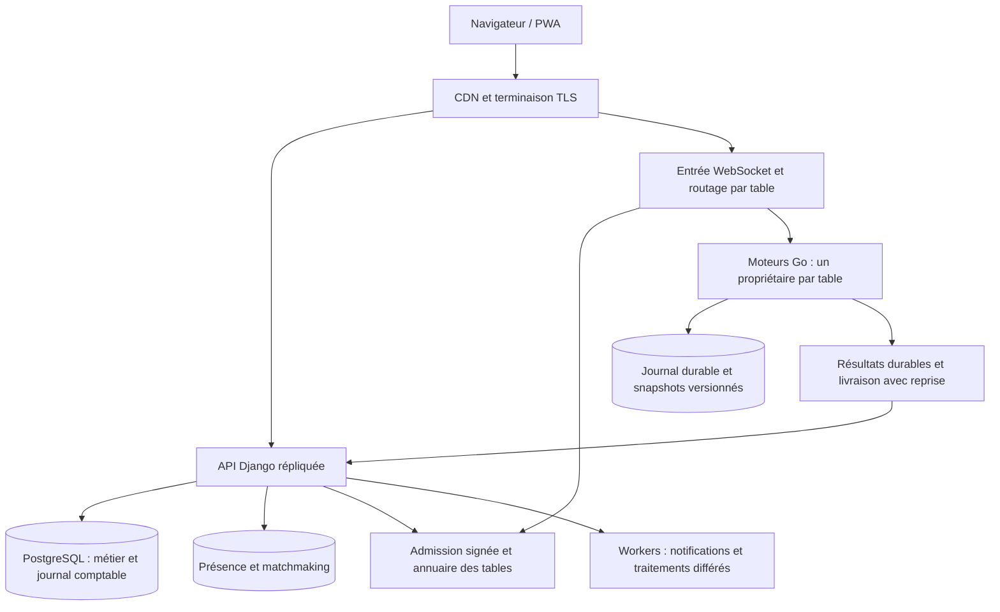

# Audit produit, multijoueur et architecture — 14 septembre 2026

## Conclusion

Le socle React/TypeScript + Django/PostgreSQL + moteur Go/WebSocket est pertinent. Le multijoueur est implémenté en partie, mais les défauts constatés empêchent de qualifier l'application pour 10 000 joueurs simultanés. Une consolidation ciblée est préférable à une réécriture complète.

Périmètre : dépôt à partir de `c1b95c6`, incluant les modifications locales existantes, inspection de l'accueil servi sur le port 3000 et contrôles locaux. Les fichiers applicatifs n'ont pas été modifiés par cet audit. La roadmap `docs/20-Roadmap-Activation-Multijoueur-Jeux-Test.md` fixe un périmètre simulation : aucune activation de l'argent réel n'est proposée.

10 000 comptes, 10 000 utilisateurs quotidiens et 10 000 connexions simultanées sont trois objectifs différents. Les recommandations ci-dessous prennent le troisième comme hypothèse de dimensionnement. Aucun test de charge à cette échelle n'a été exécuté.

## Contrôles exécutés et limites

| Contrôle | Résultat |
|---|---|
| `npm test` | PASS : 2 tests, un seul fichier |
| `npm run build` | PASS : TypeScript et build Vite/PWA |
| `npm run lint` | FAIL : 4 erreurs et 5 avertissements |
| Backend `pytest -q -p no:cacheprovider --tb=short` | 91 réussites, 1 échec, 3 avertissements ; 110,44 s |
| Moteur `go test -race -timeout 90s ./...` | PASS sur les paquets testés, dans une copie isolée en conteneur Go 1.21 |
| Accueil servi sur `http://127.0.0.1:3000` | Lecture et captures mobile/desktop effectuées |
| Largeur mobile 390 px | Largeur du document mesurée : 390 px |
| Axe sur accueil mobile | Aucune violation détectée |
| Parcours humain complet entre plusieurs navigateurs réels | Non exécuté |
| Charge à 10 000 connexions, endurance et reprise après panne | Non exécutées |

Le backend a été testé avec un nom de base de test PostgreSQL dédié et un cache mémoire, pour éviter de vider le cache actif. L'échec concerne `apps/games/test_test_games.py:34` : le catalogue contient `slots-mada`, absent de l'ensemble attendu. Il faut réconcilier le contrat produit et le test avant de décider lequel corriger. Les avertissements concernent une clé HMAC courte employée pendant des tests ; ils ne constituent pas une preuve sur les secrets de production.

Les erreurs ESLint concernent quatre conversions booléennes redondantes dans `GamePage.tsx` ; les avertissements comprennent les dépendances de hooks et les exports Fast Refresh. Le build réussi ne rend donc pas la CI entièrement verte.

Les scénarios `frontend/tests/e2e/multiplayer-journey.spec.ts` remplacent l'API et le WebSocket par des simulations. Ils ne prouvent pas le parcours distribué réel. Les tests Go réussis avec `-race` signifient qu'aucune course n'a été détectée dans les scénarios exécutés ; ils ne couvrent pas toutes les lectures concurrentes relevées par l'analyse statique.

Les premières tentatives Go dans l'image builder ont échoué faute de CGO puis de compilateur C ; le résultat final ci-dessus provient de l'image Go disposant de la chaîne de compilation nécessaire. Le frontend servi par Docker et le code du dépôt n'ont pas fait l'objet d'une vérification de parité de build : les observations navigateur et les constats de code sont distingués.

## Éléments à conserver

- Séparation API métier / moteur temps réel ; Django peut rester un monolithe modulaire.
- Moteurs poker, belote et rami côté serveur, mélange utilisant `crypto/rand`.
- Événements séquencés, début d'idempotence des actions, snapshots et reconnexion.
- Projection privée des cartes par destinataire, accès spectateur en lecture seule.
- Transactions SQL, journal comptable SIM avec deux écritures, clés d'idempotence.
- Modes humain, IA et simulation, fonctionnalités de clubs, invitations et feedback existantes.
- Build TypeScript, tests backend et Go, Playwright, Prometheus et CI déjà présents.

Ces éléments sont des fondations ; leur présence ne garantit pas un parcours complet, une haute disponibilité ou une capacité mesurée.

## Défauts et risques prioritaires

### P0 — Authentification et admission WebSocket

`game-engine/internal/websocket/server.go:1203` vérifie la signature du JWT et `sub`, mais ne vérifie pas `exp`. L'expiration est contrôlée pour les jetons bots, pas pour les joueurs. `CheckOrigin` accepte toutes les origines. Aucun `SetReadLimit` ni quota de messages n'est présent dans le lecteur.

`handleJoin` (ligne 272) accepte une table fournie par le client et peut la créer à partir du type de jeu reçu si aucun snapshot n'est disponible. Il ne consulte pas l'autorisation métier Django, l'invitation, le mode ou une réservation de siège. Les contrôles des tables privées dans l'API HTTP ne suffisent donc pas à protéger le chemin WebSocket direct.

Correction : jeton d'admission court signé par l'API, lié au joueur, à la table, au siège, au rôle et au mode ; validation complète des claims avec une bibliothèque JWT ; origine autorisée ; limites de taille, de débit et de connexions ; distinction entre snapshot absent et stockage indisponible.

### P0 — Résultats incompatibles avec plusieurs joueurs et plusieurs manches

`backend/apps/games/models.py:139` définit `game_id` unique globalement. `frontend/src/pages/GamePage.tsx:1056` envoie l'identifiant de table comme identifiant de partie. `backend/apps/games/views.py:548` refuse un résultat déjà associé à un autre joueur. Une table ne peut donc pas enregistrer normalement tous ses participants et toutes ses manches.

La signature du résultat (`server.go:1130`, `views.py:40`) ne contient pas l'identité du bénéficiaire. Les résultats signés sont diffusés à la table. L'API attribue le résultat au demandeur sans vérifier son siège : le mécanisme ne lie pas de manière sûre une victoire à son bénéficiaire. Il faut corriger cette possibilité d'attribution abusive, y compris en simulation.

Le navigateur déclenche lui-même l'enregistrement. Une fermeture ou une panne du navigateur peut interrompre cette étape.

Correction : distinguer Table, Session, Manche, Participant et Résultat ; unicité `(manche, joueur)` ; commandes de règlement entre serveurs, durables et idempotentes ; identité, mode, devise et montant liés au résultat ; réconciliation des règlements. Le navigateur consulte l'état du règlement et peut demander une nouvelle lecture.

### P1 — Matchmaking et règles de partie

`backend/apps/games/matchmaking.py:20` associe deux joueurs et crée une nouvelle table, y compris pour la belote. Le moteur exige quatre joueurs (`belote.go:80`). La file ne constitue pas automatiquement un groupe de quatre dans cette branche. Le choix d'un adversaire ne filtre pas les tickets par présence fraîche.

Les paramètres de capacité `MaxTables` et `MaxPlayersPerTable` sont déclarés mais non appliqués par les chemins de création/admission inspectés. Les sièges HTTP et ceux du moteur évoluent séparément. Les arrivées en cours de manche doivent être gérées explicitement.

`manager.go:1197` autorise `new_hand` pour un joueur assis. Les branches belote/rami n'exigent pas la fin de manche avant réinitialisation, contrairement au poker. `rami.go:54` n'impose pas un état « a déjà pioché » : des pioches répétées au même tour doivent être interdites côté serveur.

Correction : machine à états par jeu et par table, commandes légales à chaque état, matchmaking par taille de groupe, expiration serveur des tickets, réservation atomique des sièges et définition des comportements de départ/reconnexion.

### P1 — Concurrence Go et ordonnancement

`GetTable` retourne un pointeur mutable. `broadcastState` (`server.go:1073`) lit les joueurs, la séquence et le jeu sans verrou de table, alors que les commandes les modifient sous verrou. Le verrou du serveur de connexions ne protège pas ces données. Risques de courses et d'images incohérentes à qualifier avec le détecteur de courses.

L'orchestration des bots et délais se trouve dans le transport WebSocket. Les redémarrages et annulations de goroutines, les relances automatiques de manches et les délais humains sont imbriqués avec les émissions réseau.

Correction : une boucle de commandes sérialisées par table, snapshots immuables pour la diffusion, ordonnanceur possédé par la table, annulation explicite des tâches et tests des doubles connexions, départs et temporisations.

### P1 — Réplication et reprise non garanties

Les tables et connexions sont des maps locales au processus. Il n'existe pas de propriétaire distribué de table dans le chemin inspecté. Deux moteurs peuvent charger la même table et la faire évoluer indépendamment. Une affinité par utilisateur n'assure pas que tous les participants arrivent au même moteur.

Les snapshots expirent après cinq minutes (`internal/state/snapshot.go:24`). Ils sont écrits dans des goroutines indépendantes par simple `SET` (`server.go:1137`) : une sauvegarde ancienne peut terminer après une nouvelle. L'historique complet est inclus et croît avec les actions.

Redis est configuré à 256 Mo avec `allkeys-lru` (`docker-compose.yml:33`). Sous pression mémoire, cette politique peut supprimer des snapshots avant leur expiration. L'AOF ne remplace pas une stratégie de conservation des parties.

Correction : annuaire `table_id → moteur propriétaire`, bail et numéro de génération permettant de rejeter un ancien propriétaire ; routage par table ; snapshots versionnés avec rejet des versions anciennes ; journal durable des actions acceptées ; restauration et rejeu testés ; séparation du cache jetable et de l'état de jeu.

### P1 — Coût de diffusion et croissance mémoire

`broadcastToTable` (`server.go:1188`) et plusieurs fonctions voisines parcourent tous les clients du serveur à chaque émission pour une seule table. Le coût dépend donc de la population totale, même pour une partie à deux.

Chaque connexion réserve une file de 1 024 messages. Les envois peuvent être abandonnés silencieusement quand la file est pleine. Les événements sont conservés dans une liste sans borne ; l'idempotence les parcourt. La suppression des tables fermées n'est pas orchestrée dans les chemins inspectés. Le calcul des probabilités poker est répété dans les projections privées.

Correction : index des connexions par table, files bornées avec politique explicite de resynchronisation/déconnexion des clients lents, rétention et archivage d'événements, nettoyage des tables et profilage des calculs avant optimisation.

### P1 — Pression API, présence et portefeuille

Le lobby émet un heartbeat et une lecture de statut toutes les 15 secondes, puis une lecture toutes les 2,5 secondes pendant l'attente (`LobbyPage.tsx:96`). Avec 10 000 utilisateurs tous dans cet état, cela représente environ 5 333 requêtes/s, hors autres appels. C'est un calcul de scénario, pas une mesure de trafic observé.

La présence est mise à jour dans PostgreSQL. Les listes de tables sont construites intégralement dans une `APIView`, sans pagination effective malgré les réglages généraux DRF. Les opérations de portefeuille verrouillent le même compte plateforme, créant un point de contention potentiel.

Correction : présence éphémère avec TTL, notifications de matchmaking, listes paginées et index adaptées, télémétrie regroupée/échantillonnée, pool de connexions SQL. Mesurer la contention comptable et adapter les comptes de contrepartie/agrégats en conservant les invariants du journal.

## Produit, UI et UX

L'accueil réellement servi a été inspecté en viewport mobile 390 × 844. Son identité sombre et dorée est cohérente ; la page ne présente pas de débordement horizontal mesuré. Le scan axe de cet accueil ne remonte aucune violation. Cela ne qualifie ni les tables, ni les fenêtres modales, ni l'utilisation au clavier ou sur téléphone physique.

Améliorations proposées :

1. Faire apparaître le choix « Humains / Entraînement IA / Amis » et le caractère SIM au moment du choix de partie. Conserver les fonctionnalités existantes, mais réduire le nombre de décisions avant la première partie.
2. Remplacer les données statiques « Reprendre la partie », « il y a 12 min », nombre de sièges et tournoi de l'accueil (`HomePage.tsx:441`, traductions FR) par des données persistées, ou un état vide honnête. L'accueil les affiche même sans connexion.
3. Harmoniser les règles : `PlayHubPage.tsx` annonce dix cartes au rami ; `rami.go:43` en distribue sept. Choisir et documenter la variante puis aligner moteur, aide, bots et tests.
4. Justifier ou retirer la promesse « Provably Fair » de l'accueil : un générateur aléatoire cryptographique n'est pas à lui seul une procédure de vérification publique. Le protocole de preuve utilisateur reste à établir dans ce périmètre.
5. Montrer clairement « en attente de joueurs », « votre tour », « reconnexion », « action en attente de confirmation », « résultat en cours d'enregistrement ». Préserver la main et rendre la reprise compréhensible après coupure mobile.
6. Reporter les réglages avancés des bots dans l'entraînement. Réduire la densité de l'accueil et privilégier des cibles tactiles confortables, des cartes lisibles et une barre d'action stable.
7. Valider sur Android modeste, en français et malgache, réseau instable, animations réduites, lecteur d'écran et navigation clavier. Les animations ne doivent pas retarder une action ni masquer le temps restant.

## Architecture cible proposée

Le dessin est une cible, pas l'infrastructure déployée. Le mécanisme de publication durable doit éviter la fenêtre « résultat enregistré dans le moteur mais message perdu » ; utiliser un outbox ou une relecture fiable du journal avec consommateur idempotent.

Déployer d'abord dans une région proche des joueurs après mesure de latence. Répartir les instances sur plusieurs domaines de panne ; PostgreSQL sauvegardé avec restauration à un instant donné et exercices de restauration ; état de jeu protégé ; stockage objet pour archives ; secrets gérés ; métriques, alertes et traces corrélées par table/manche.

Un orchestrateur de conteneurs géré peut suffire. Kubernetes n'est utile que si les besoins d'exploitation et les compétences le justifient. Il ne résout pas à lui seul la propriété des tables ou la cohérence des résultats. Aucun fournisseur, nombre définitif de serveurs ou budget n'est justifiable sans profil de charge.

## Modernisation et maintenabilité

- Django réellement installé : 5.2.17. La branche 5.2 est LTS ; la conserver à jour est raisonnable. Verrouiller les versions Python, actuellement exprimées principalement comme minima/plages.
- Go 1.21 est utilisé par le Dockerfile et la CI, et confirmé dans l'image builder. Il est hors support selon la politique Go ; migrer vers une branche supportée et qualifier les dépendances.
- Le frontend compile avec Vite 8.2.1, mais mélange plusieurs générations de bibliothèques. Inventorier les usages et procéder par migrations limitées, sans cumuler refonte métier et mise à niveau globale.
- Découper `GamePage.tsx` (2 985 lignes) par jeu, état réseau et présentation ; séparer `games/views.py` (1 020 lignes) par cas d'usage ; extraire les bots et la gestion de table de `manager.go` (1 945 lignes).
- Versionner le contrat WebSocket et formaliser les contrats HTTP ; générer les types quand possible et tester leur compatibilité.
- Le Compose actuel correspond au développement : instances uniques, nombreuses publications de ports, Vault en mode dev, images `latest`. Créer une configuration de production distincte et reproductible.
- La CI contient `mypy ... || true`, `safety ... || true`, et un déploiement staging sous forme d'`echo`. Faire bloquer les contrôles pertinents et implémenter réellement déploiement, rollback et drainage des parties.

## Qualification de 10 000 joueurs simultanés

À quatre joueurs par table en moyenne, 10 000 joueurs représentent environ 2 500 tables. À deux, environ 5 000. Les spectateurs, bots et utilisateurs présents uniquement dans le lobby changent fortement le coût.

Exemple de trafic : un état moyen de 2 Ko envoyé une fois par seconde à 10 000 joueurs représente 20 Mo/s de données applicatives sortantes, avant TLS et autres événements. Mesurer le vrai poids des états et les fréquences avant tout dimensionnement.

Plan de qualification :

| Étape | Preuve attendue |
|---|---|
| Parties réelles | 2 navigateurs au poker/rami, 4 à la belote ; cartes privées, tours, départs, plusieurs manches et résultats persistés pour tous |
| Concurrence et invariants | Détecteur de courses, commandes répétées/hors ordre, conservation des jetons, cartes uniques et transitions légales |
| Charge progressive | 100 → 1 000 → 5 000 → 10 000 → 15 000 connexions, avec authentification, matchmaking, actions, résultats et lectures |
| Endurance | Plusieurs heures à charge cible ; mémoire et files stabilisées, latence et erreurs suivies |
| Pannes | Perte d'un moteur, Redis indisponible, latence SQL, coupure réseau, reprise et déploiement pendant des parties |
| Intégrité | Aucune action annoncée acceptée puis perdue, aucun crédit double, chaque participant enregistré, réconciliation sans écart |

Objectifs initiaux à convenir : traitement serveur des actions p95 < 100 ms, aller-retour joueur p95 < 300 ms sur un profil réseau défini, erreurs techniques < 0,1 %, restauration de table < 30 s, au moins 30 % de réserve sur les ressources limitantes. Ce sont des objectifs proposés, pas des résultats obtenus. La latence d'un réseau mobile dégradé doit être suivie séparément.

Utiliser des générateurs de charge externes à l'application, avec scénarios HTTP/WebSocket, répartition réaliste des jeux et mesure des générateurs eux-mêmes. k6 fournit les primitives WebSocket adaptées. Un benchmark de fonction Go ne remplace pas cette preuve.

## Ordre de livraison conseillé

1. **Fiabilité et admission** : résultats par manche/joueur, authentification, règles et matchmaking ; tests de non-régression ciblés.
2. **Multijoueur réel et UX** : parcours complets multi-navigateurs, départ/reconnexion, messages et aide exacts, reprise persistée.
3. **Concurrence et reprise** : isolation des tables, journal, ordonnancement, files bornées, propriétaire unique et bascule.
4. **Infrastructure et capacité** : configuration de production, supervision, sauvegardes, migrations de versions, essais de charge et de panne.
5. **Pilote puis ouverture progressive** : validation avec de vrais joueurs et seuils go/no-go, avant une promesse publique de capacité.

## Sources externes consultées

- [Versions Django et support](https://www.djangoproject.com/download/).
- [Politique de support et versions Go](https://go.dev/doc/devel/release).
- [Éviction des clés Redis](https://redis.io/docs/latest/develop/reference/eviction/).
- [Tests WebSocket avec k6](https://grafana.com/docs/k6/latest/using-k6/protocols/websockets/).
